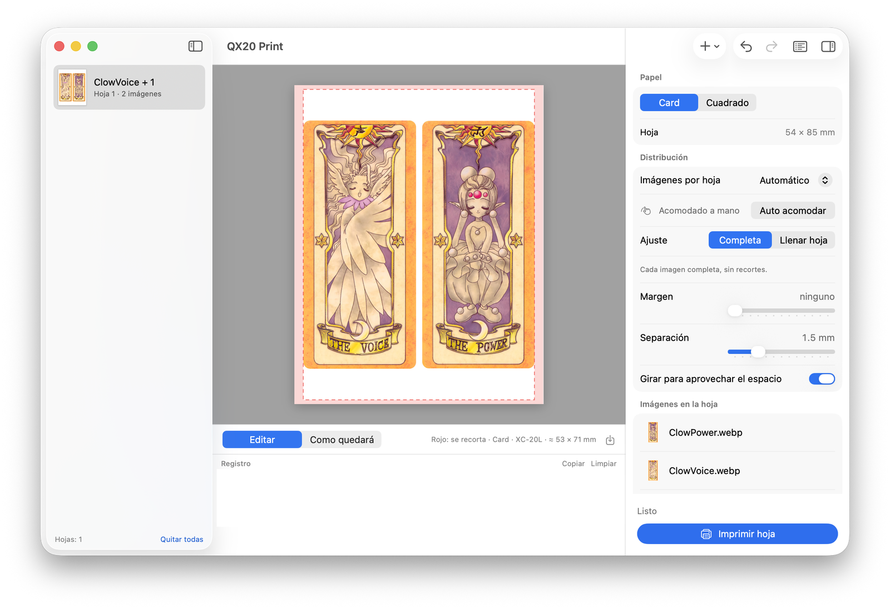

# QX20 Print

[English](README.md)

Una app nativa para Mac que imprime fotos, stickers y collages en una
**Canon SELPHY QX20**, sin la app de Canon, sin celular y sin drivers. Hecha
en SwiftUI: sin Electron, sin motor de navegador y sin Python.

<p align="center"></p>

La app está en **español e inglés** y usa el idioma de tu Mac (inglés para
cualquier otro idioma).

- **Vista previa sobre el papel real.** La franja que se recorta al imprimir
  sin bordes aparece en rojo, o cambia a *Como quedará* para ver exactamente
  lo que se imprime.
- **Hojas y capas.** Suelta fotos, PNG (con transparencia) o SVG, y luego
  muévelos, escálalos, gíralos y **recórtalos**. **Auto acomodar** busca la
  distribución que deja todo más grande; *N por hoja* + *Llenar con copias*
  arma hojas de stickers. Guías de corte opcionales.
- **Imprimir con un clic.** La app se conecta sola al Wi-Fi de la impresora,
  imprime y regresa tu Mac a tu red de siempre.
- **Las hojas se guardan** entre sesiones.
- **También desde la terminal:** `qx20 print foto.jpg`, con salida JSON y
  códigos de salida estables para scripts y agentes de IA; ver
  [docs/CLI.md](docs/CLI.md) (en inglés).

## Instalación

### Opción A: descargar

1. Descarga `QX20-Print-<versión>-macOS.zip` de
   [Releases](https://github.com/danielcardeenas/qx20-print/releases), descomprímelo y mueve **QX20 Print** a
   *Aplicaciones*.
2. La app no está firmada con una cuenta de pago de Apple Developer, así que
   la primera vez macOS dirá que no puede verificar al desarrollador. Puedes:
   - **hacer clic derecho en la app › Abrir › Abrir**, o
   - intentar abrirla una vez y luego ir a *Ajustes del Sistema › Privacidad y
     seguridad* y hacer clic en **Abrir de todas formas**.

   Solo hay que hacerlo una vez. Si lo prefieres, revisa el código y
   compílala tú (opción B).

### Opción B: compilar el código

Necesitas macOS 14 o posterior y Xcode 15 o posterior (o las Command Line
Tools con Swift 5.10+).

```bash
git clone https://github.com/danielcardeenas/qx20-print.git
cd qx20-print
./build-app.sh --install        # compila y la copia a /Applications
open "/Applications/QX20 Print.app"
```

Ábrela desde **/Applications**: macOS no puede verificar apps dentro de tu
carpeta de usuario, así que nunca les da el permiso de Ubicación (si la abres
desde otro lugar, la app ofrece moverse sola).

`./build-app.sh --release` compila una app universal (Apple Silicon + Intel)
y el zip para Releases. También puedes abrir `Package.swift` en Xcode.

## Primera vez

1. **Permite el acceso a Ubicación** cuando macOS lo pida. La app nunca lee
   tu ubicación: macOS solo muestra los *nombres* de las redes Wi-Fi a apps
   con acceso a Ubicación, y la app los necesita para encontrar la red de la
   impresora.
2. Abre **Ajustes** (⌘,) y escribe la **clave de la impresora**: abre la tapa
   del cartucho de tinta y verás una cadena de 9 caracteres. Esa es la clave;
   la red de la impresora se llama `QX20-` seguido de sus últimos 3
   caracteres. Deja *Red* vacía y la app la encuentra sola.
3. Prende la impresora, carga papel y tinta, agrega una foto y presiona
   **Imprimir hoja**.

## Línea de comandos

```bash
qx20 setup                                  # primera vez: permiso, clave, impresoras
qx20 print foto.jpg                         # se conecta a la impresora, imprime y regresa
qx20 print logo.svg --per-sheet 6 --repeat --guides
qx20 status --json
```

Referencia completa, salida JSON y códigos de salida: [docs/CLI.md](docs/CLI.md).

## Uso

| | |
|---|---|
| Suelta fotos en la **barra lateral** | una hoja por foto |
| Suelta imágenes en el **lienzo** | se agregan a la hoja actual |
| Arrastra una imagen | moverla, con guías que la alinean con otras imágenes, el centro, las orillas y la línea de corte (mantén ⌘ para colocarla libre) |
| Cuadritos de las esquinas | escalar desde la esquina opuesta |
| Barritas de los lados · ⌥ + esquina | recortar ese lado · recortar dos lados |
| Circulito de arriba | girar (se ajusta cada 45°) |
| Doble clic, `C` o ⌘K | modo recorte: además arrastra dentro para mover la imagen; Return aplica, Esc cancela |
| ⌫ · Esc · Tab | quitar · soltar · siguiente imagen |
| `+` `-` · flechas (⇧ ×10) | tamaño · mover |
| ⌘D · ⌘R · ⌘Z | duplicar · girar 90° · deshacer |
| ⌘P · ⇧⌘P | imprimir hoja · imprimir todas |

## Problemas comunes

- **Se prende el foco rojo y no imprime nada:** casi siempre el cartucho de
  papel está vacío (la impresora sigue reportando el cartucho como puesto).
  Carga papel y apaga y prende la impresora.
- **"No se encontró ninguna red QX20":** la impresora está apagada o su
  Wi-Fi está dormido. Préndela y presiona **Comprobar**.
- **"macOS oculta los nombres de las redes Wi-Fi":** da acceso a Ubicación a
  QX20 Print en *Ajustes del Sistema › Privacidad y seguridad › Localización*.
- **Cualquier otra cosa:** el registro de abajo muestra cada paso; **Copiar**
  lo pone en el portapapeles para reportar un issue.

## Privacidad

- La app solo se comunica con la impresora (192.168.0.1 en su propia red
  Wi-Fi Direct). No usa internet.
- La clave de la impresora se guarda en las preferencias de la app. No es
  una contraseña personal: viene impresa en la impresora y solo da acceso a
  su red local.
- Las imágenes que agregas se copian a
  `~/Library/Application Support/QX20 Print/` para que las hojas guardadas
  sigan funcionando aunque muevas los originales. Las copias que ya no se
  usan se borran solas.

## Desarrollo

Detalles del repositorio, pruebas sin impresora, traducciones y las
herramientas de Python: ver el [README en inglés](README.md#repository).

## Créditos

Basado en [loveletter-qx20](https://github.com/Neige-Neige/loveletter-qx20)
de Uzu y Solinelle, la primera implementación de código abierto del
protocolo CPNP de la QX20. Su licencia MIT y su aviso de copyright se
conservan en `LICENSE`.

No está afiliado a Canon ni respaldado por Canon. SELPHY es una marca de
Canon Inc.

Hecho por [Daniel Cardenas](https://github.com/danielcardeenas).

## Licencia

MIT: ver [LICENSE](LICENSE).
