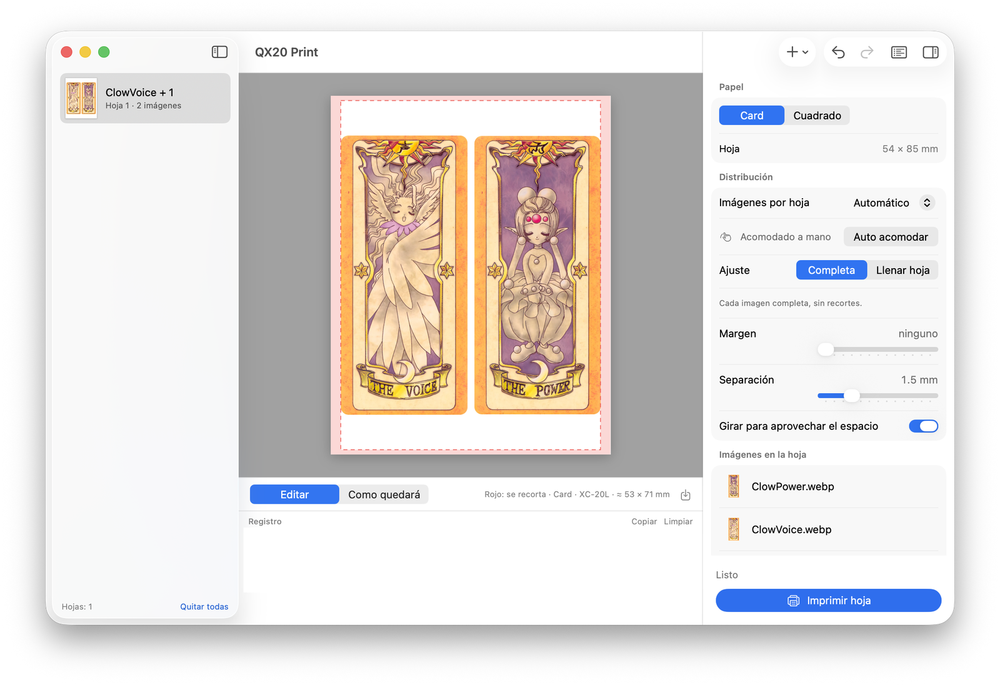

# QX20 Print

[Español](README.es.md)

A native Mac app to print photos, stickers and collages on a **Canon SELPHY
QX20** — no Canon app, no phone, no driver. Pure SwiftUI: no Electron, no
browser engine, no Python.

<p align="center"></p>

The app is in **English and Spanish** and follows your Mac's language
(English for any other language).

- **Live preview on the real paper.** The strip that borderless printing cuts
  off is shaded in red, or switch to *Result* to see exactly what will print.
- **Sheets and layers.** Drop photos, PNGs (with transparency) or SVGs, then
  move, scale, rotate and **crop** them. **Auto-Arrange** finds the layout
  that makes everything largest; *N per sheet* + *Fill with copies* makes
  sticker sheets. Optional thin cut guides.
- **One-click printing.** The app joins the printer's Wi-Fi by itself, prints
  and returns your Mac to your usual network.
- **Sheets are saved** between launches.
- **Command line too:** `qx20 print photo.jpg`, with JSON output and stable
  exit codes for scripts and AI agents — see [docs/CLI.md](docs/CLI.md).

## Install

### Option A — download

1. Download `QX20-Print-<version>-macOS.dmg` from
   [Releases](https://github.com/danielcardeenas/qx20-print/releases), open it and drag **QX20 Print** to
   *Applications*.
2. The app is not signed with a paid Apple Developer ID, so the first time
   macOS says it can't verify the developer. Either:
   - **right-click the app › Open › Open**, or
   - try to open it once, then go to *System Settings › Privacy & Security*
     and click **Open Anyway**.

   You only need to do this once. If you prefer, read the code and build it
   yourself (option B).

### Option B — build from source

Requires macOS 14 or later and Xcode 15 or later (or the Command Line Tools
with Swift 5.10+).

```bash
git clone https://github.com/danielcardeenas/qx20-print.git
cd qx20-print
./build-app.sh --install        # builds and copies it to /Applications
open "/Applications/QX20 Print.app"
```

Run it from **/Applications**: macOS can't verify apps inside your user
folder, so it never grants them the Location permission (the app offers to
move itself if you open it from elsewhere).

`./build-app.sh --release` builds a universal app (Apple Silicon + Intel)
and the dmg used for Releases. You can also open `Package.swift` in Xcode.

## First run

1. **Allow Location access** when macOS asks. The app never reads your
   location: macOS only shows Wi-Fi network *names* to apps with Location
   access, and the app needs them to find the printer's network.
2. Open **Settings** (⌘,) and type the **printer key**: open the ink cassette
   cover and you'll see a 9-character string. That's the key; the printer's
   network is `QX20-` followed by its last 3 characters. Leave *Network*
   empty and the app finds it by itself.
3. Turn the printer on, load paper and ink, add a photo and press
   **Print Sheet**.

## Command line

```bash
qx20 setup                                  # first time: permission, key, printers
qx20 print photo.jpg                        # joins the printer Wi-Fi, prints, comes back
qx20 print logo.svg --per-sheet 6 --repeat --guides
qx20 status --json
```

Full reference, JSON output and exit codes: [docs/CLI.md](docs/CLI.md).

## Using it

| | |
|---|---|
| Drop photos on the **sidebar** | one sheet per photo |
| Drop images on the **canvas** | add them to the current sheet |
| Drag an image | move, with smart guides that snap to other images, the centre, the edges and the cut line (hold ⌘ to place freely) |
| Corner squares | resize from the opposite corner |
| Side bars · ⌥ + corner | crop that side · crop two sides |
| Top knob | rotate (snaps every 45°) |
| Double-click, `C` or ⌘K | crop mode: also drag inside to slide the image; Return applies, Esc cancels |
| ⌫ · Esc · Tab | remove · deselect · next image |
| `+` `-` · arrows (⇧ ×10) | size · move |
| ⌘D · ⌘R · ⌘Z | duplicate · rotate 90° · undo |
| ⌘P · ⇧⌘P | print sheet · print all |

## Troubleshooting

- **Red light on the printer, nothing printed:** usually the paper cassette
  is empty (the printer still reports the cassette as present). Load paper
  and turn the printer off and on.
- **"No QX20 network found":** the printer is off or its Wi-Fi is asleep.
  Turn it on and press **Check**.
- **"macOS hides Wi-Fi network names":** give Location access to QX20 Print
  in *System Settings › Privacy & Security › Location Services*.
- **Anything else:** the log at the bottom shows every step; **Copy** puts it
  on the clipboard for an issue report.

## Privacy

- The app only talks to the printer (192.168.0.1 on its own Wi-Fi Direct
  network). It doesn't use the internet.
- The printer key is stored in the app's preferences. It isn't a personal
  password: it's printed on the printer and only opens its local network.
- Images you add are copied to `~/Library/Application Support/QX20 Print/`
  so saved sheets keep working if you move the originals. Copies no longer
  used are deleted automatically.

## Repository

| Path | What |
|---|---|
| `Sources/QX20Core/CPNP.swift` | Canon CPNP printer protocol |
| `Sources/QX20Core/JPEGEncoder.swift` | Baseline JPEG, 4:4:4 + restart markers: the format the QX20 accepts (ImageIO can't produce it) |
| `Sources/QX20Core/Composition.swift` | Layers, crop, SVG, auto-layout, page rendering |
| `Sources/QX20Core/WiFi.swift` | Join / leave the printer network (CoreWLAN) |
| `Sources/QX20Core/PrintJob.swift` | Network switching, watchdog, retries |
| `Sources/QX20Print/` | SwiftUI app |
| `Sources/qx20/` | `qx20` command line tool ([docs/CLI.md](docs/CLI.md)) |
| `Resources/*.lproj` | English and Spanish strings |
| `scripts/fake_qx20.py` | Fake printer to test without hardware |
| `scripts/localize.py` | Extracts strings and checks the Spanish translation |
| `python/` | Python driver, calibration and command-line printing |

### Translations

Source strings are English. After changing UI text, add the Spanish to
`scripts/es_translations.py` and run:

```bash
python3 scripts/localize.py     # fails listing any missing translation
```

### Testing without the printer

```bash
python3 scripts/fake_qx20.py --log /tmp/fake.jsonl &     # --fail-paper simulates an empty cassette
swift build -c release
.build/release/qx20 print photo.jpg --ip 127.0.0.1 --port 18610 --local-port 18609
```

The fake printer logs every packet. The Swift driver's traffic matches the
Python driver's byte for byte (except the JPEG, whose format matches
Pillow's).

### Python tools

`python/` has the Python driver (extended from loveletter-qx20) for
printing from the terminal:

```bash
cd python
python3 -m venv .venv && .venv/bin/pip install -r requirements.txt
.venv/bin/python qx20.py photo.jpg --paper card --mode fit     # Mac already on the printer's Wi-Fi
.venv/bin/python calibrate.py card target.png                  # bleed calibration target
./qx20-print.sh photo.jpg                                      # joins the printer Wi-Fi, prints, returns
```

`qx20-print.sh` reads `QX20_SSID` and `QX20_PASS` from `python/.qx20.env`.

### Printer facts (measured on a QX20)

- 287 dpi. Canvas: card 644×826 px, square 848×826 px.
- Card bleed: about 2 mm left/right and ≤1 mm top/bottom.
- Print states: `01` ready → `03`/`05`/`07` colour passes → `09` overcoat →
  `10` → `0A` done; `0C`/`0D` = error (red light).
- `StartPrint` media codes: card (XC-20L) **18**, square (XS-20L) **17**
  (code from [Crocmagnon/selphy-qx20](https://github.com/Crocmagnon/selphy-qx20),
  verified on hardware). A wrong code makes the status light blink red; turn
  the printer off and on again.

## Credits

Based on [loveletter-qx20](https://github.com/Neige-Neige/loveletter-qx20)
by Uzu and Solinelle, the first open-source implementation of the QX20's CPNP
protocol. Their MIT license and copyright notice are kept in `LICENSE`.

Not affiliated with or endorsed by Canon. SELPHY is a trademark of Canon Inc.

Made by [Daniel Cardenas](https://github.com/danielcardeenas).

## License

MIT — see [LICENSE](LICENSE).
